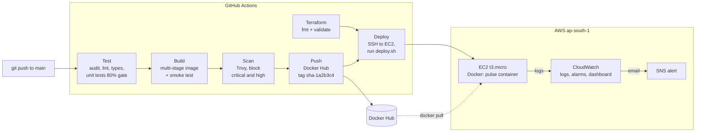

# Dockerized CI/CD Pipeline

[](https://github.com/vishi-vishnu/dockerized-cicd-pipeline/actions/workflows/ci-cd.yml)

Every push to `main` is tested, built into a Docker image, scanned for security issues, pushed to Docker Hub with the commit SHA as its tag, and deployed to an AWS EC2 server over SSH. After the deploy, a health check runs. **If the new version is unhealthy, the server rolls back to the previous image by itself** and the pipeline turns red.

The app being shipped is **Pulse**, a small Node.js status page. It shows which version is live and the full deployment history, including rollbacks, so you can watch the pipeline work from the browser.

**Stack:** GitHub Actions · Docker (multi-stage) · Docker Hub · AWS EC2 · Terraform · CloudWatch (logs, alarms, dashboard) · Trivy · Node.js 24 + TypeScript · Vitest

## How it works



### What `deploy.sh` does on the server

1. `docker pull` the new tag.
2. Stop the running container but **keep it** (renamed to `pulse-old`).
3. Start the new container and call `/health` every 3 seconds for up to 1 minute.
4. **Healthy:** delete the old container, write `success` to the deployment history.
5. **Not healthy:** print its logs, delete it, start `pulse-old` again, write `rolled_back`, and exit with an error so the pipeline fails.

The pipeline then checks the live site from the internet and confirms `/health` reports the new commit.

**Try the rollback yourself:** Actions > CI/CD > Run workflow > tick `simulate_bad_release`. It ships an image that passes CI but fails its health check on the server, and you can watch the server roll back. See [docs/SETUP.md](docs/SETUP.md#demo-watch-the-automatic-rollback).

## What is in the repo

| Path | What it is |
| --- | --- |
| `src/` | The Express app: `/`, `/health`, `/api/info`, `/api/deployments`, `/metrics` |
| `test/` | Vitest + Supertest tests (coverage must stay at 80% or more) |
| `public/` | The status page (HTML, CSS, a small script) |
| `Dockerfile` | Two stages: build with TypeScript, run with only production files, as a non-root user |
| `docker-compose.yml` | Run the production image on your laptop |
| `scripts/deploy.sh` | Deploy with health check and automatic rollback, runs on EC2 |
| `.github/workflows/ci-cd.yml` | The pipeline |
| `.github/workflows/rollback.yml` | One-click manual rollback to any earlier tag |
| `.github/dependabot.yml` | Weekly update pull requests for npm, Docker, Actions and Terraform |
| `infra/terraform/` | EC2, security group, IAM role, Elastic IP, CloudWatch logs, alarms, dashboard, budget |
| `docs/SETUP.md` | Step by step: Docker Hub, AWS account, Terraform, GitHub secrets, first deploy, rollback demo |

## Run it on your computer

```bash
npm ci
npm run dev          # http://localhost:3000
npm run check        # lint + type check + tests

docker compose up --build   # the real production image, http://localhost:3000
```

## Endpoints

| Path | Returns |
| --- | --- |
| `/` | Status page: version, commit, uptime, deployment history |
| `/health` | `{"status":"ok","version":"1.0.12","commit":"<sha>","uptimeSeconds":42}` |
| `/api/info` | Build and runtime details |
| `/api/deployments` | Last 20 deploys, newest first |
| `/metrics` | Request counts and uptime in Prometheus format |

## Design choices

- **Image tag = commit SHA.** Every image points to the exact code it came from. `latest` is only a convenience; deploys always use the SHA tag, so a rollback is just "run the previous tag".
- **Multi-stage build.** TypeScript and dev packages stay in the build stage. The final image has Node, production packages and compiled JavaScript only, runs as the `node` user, and has a `HEALTHCHECK`.
- **Layer caching.** `package.json` is copied before the source, so `npm ci` is cached when only code changes. Buildx also caches layers between pipeline runs (`cache-from: type=gha`).
- **Secrets stay out of the code.** Docker Hub token and SSH key are GitHub Secrets. The EC2 server has no AWS keys at all; it uses an IAM role that can only write to its own log group.
- **Pull requests never deploy.** They run tests, build and the image scan only.
- **Infrastructure as code.** The whole AWS setup is in Terraform, so it can be destroyed and rebuilt in minutes.

## What I would add next

- Deploy through **AWS Systems Manager** with **GitHub OIDC** instead of SSH, so port 22 can be closed and no long-lived key is stored.
- **Zero-downtime deploys:** start the new container on a second port behind Nginx and switch traffic only after it is healthy (today there are a few seconds of downtime during a deploy).
- A **staging** server and a manual approval before production.
- **HTTPS** with a domain name and Let's Encrypt.
- Remote Terraform state in **S3 with locking**.

## License

MIT
